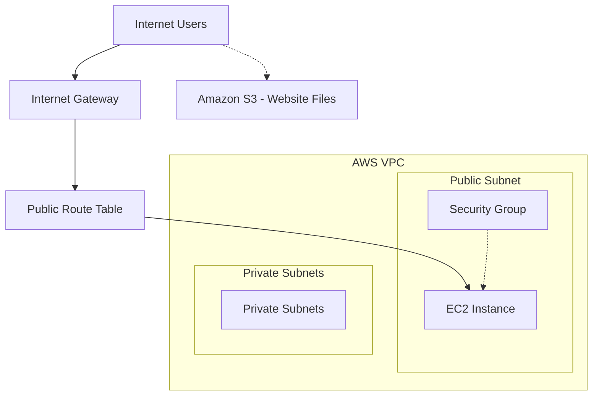

# AWS Cloud Infrastructure Architecture

## Project Overview

This project demonstrates basic AWS networking and cloud infrastructure.

## Architecture Diagram



## AWS Resources

- VPC and Subnets
- EC2 Instance
- Security Groups
- Internet Gateway
- Route Tables
- Amazon S3

## Notes

This is a logical overview of the project.
Actual network routes and resource configuration may vary.
```
